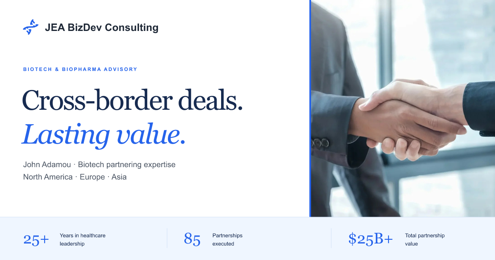

#  JEA BizDev Consulting

[](https://github.com/smeltery/jeabizdev.com/actions/workflows/ci.yml)
[](https://github.com/smeltery/jeabizdev.com/releases)


[](LICENSE)

A fast, accessible website for JEA’s biotech and biopharma advisory practice.
Explore partnering assets, transaction announcements, sixteen business development
tools, and a guided inquiry flow. Astro serves the pages; React powers the
interactive features. The original blue DNA identity and source documents remain.

[Visit JEA](https://www.jeabizdev.com) · [User guides](docs/README.md) · [Development](docs/development/setup.md)



```sh
flox activate
bun install --frozen-lockfile
bunx playwright install --only-shell chromium
bun run dev
```

Run `bun run check` inside Flox for the same gate as CI and pre-commit: formatting,
Markdown/Mermaid, source budgets, workflow/shell validation, types, unit tests,
production build, links, and desktop/mobile browser tests.

See [the documentation](docs/README.md) for using the site, editing content,
configuring inquiries, deployment, and automatic releases.

Licensed under [PolyForm Shield 1.0.0](LICENSE).
