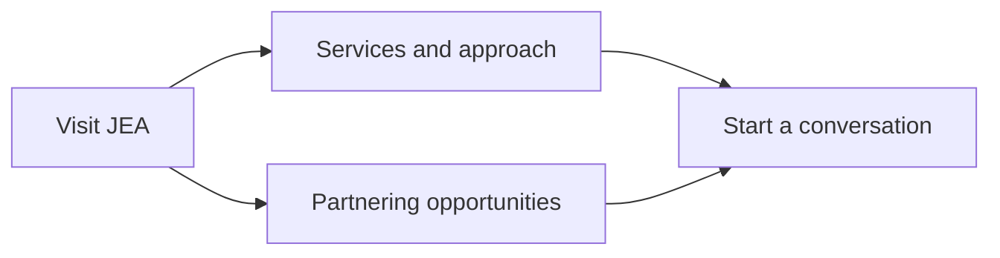

# Documentation

JEA BizDev Consulting connects biotech and biopharma companies with strategic
advice and partnering support across North America, Europe, and Asia.

## Using the website

- [Find your way around](guides/using-the-site.md): navigation, search, and resources.
- [Explore opportunities](guides/opportunities.md): assets, filters, announcements, and PDFs.
- [Contact JEA](guides/inquiries.md): introduction, consent, review, and delivery.

## Maintaining the website

- [Development setup](development/setup.md): Flox, Bun, previews, and hooks.
- [Architecture](development/architecture.md): static pages, islands, and delivery.
- [Content and branding](development/content.md): source files and editing guidance.
- [Quality and budgets](development/quality.md): CI parity, validation, and LOC limits.
- [Deployment](development/deployment.md): Vercel and environment configuration.
- [Releases](development/releases.md): verified tags and published source archives.
- [Brand provenance](brand.md) and [feature coverage](feature-coverage.md).
