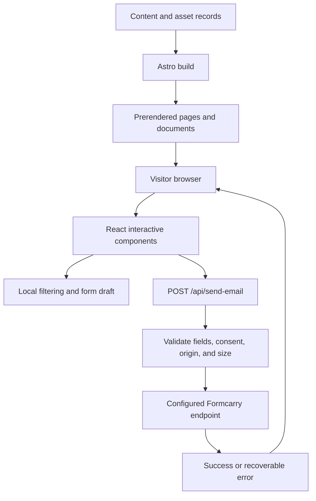

# Architecture

Astro prerenders public pages. React islands provide state only where needed:
asset filtering, select controls, and inquiry review.
Navigation, site search, and directory filtering use small browser scripts.

## Boundaries

- `src/pages/` owns routes, metadata, and asset detail pages.
- `src/components/` owns shared presentation and reusable controls.
- `src/client/` owns search, navigation, and static directory interactions.
- `src/server/` owns inquiry validation and delivery; the provider URL remains
  server-side.
- `public/` holds original PDFs, logos, fonts, and generated social assets.

Public pages remain readable without JavaScript. The inquiry page provides a
direct email option.

## Delivery and testing

Vercel receives prerendered pages plus one server function. `scripts/serve.ts`
serves built static output on an isolated loopback port for browser tests.
Those tests mock the inquiry endpoint; unit tests exercise its validation and
provider-error handling separately.

Production retains Vercel Web Analytics. Introduction text is not included in custom analytics events or browser storage.

[Deployment](deployment.md) · [Back to documentation](../README.md)
