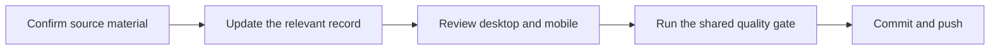

# Content and branding

## Editing map

| Content                                         | Source                                 |
| ----------------------------------------------- | -------------------------------------- |
| Services, navigation, FAQs, transaction records | `src/content/site.ts`                  |
| Published asset data                            | `data/assets.ts`                       |
| Calculator fields, formulas, examples           | `src/tools/catalog.ts` and its modules |
| Calculation behavior                            | `src/tools/calculate.ts`               |
| Original announcements                          | `public/client-showcase/`              |
| Historical summaries                            | `public/deal-summaries/`               |
| Brand files and social image                    | `public/brand/`                        |
| Social-image generator                          | `scripts/generate-og.mjs`              |
| Layout and responsive styling                   | `src/styles/`                          |

## Safe content updates

Confirm source information before changing asset stages, claims, deal values, or
availability. Preserve source PDF filenames so inbound links continue working.
Asset and tool route identifiers should remain stable; changing an identifier
requires updating links and any redirects.

JEA’s blue `#2563EB` and DNA mark come from the original live website. See
[brand provenance](../brand.md) for the supporting palette and typography.

## Social preview

Run `bun run og` after editing the generator or source globe. Inspect the generated
1200 × 630 PNG at `public/brand/social.png`, then commit both SVG and PNG.
The site metadata and README reference that PNG. Social platforms may cache it
until their next recrawl.

The renderer uses system Georgia and Arial fonts with serif/sans-serif fallbacks;
regenerate on the same design workstation for matching typography. CI verifies
the committed dimensions and references rather than rewriting the image.

[Back to documentation](../README.md)
