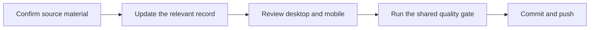

# Content and branding

## Editing map

| Content                                         | Source                    |
| ----------------------------------------------- | ------------------------- |
| Services, navigation, FAQs, transaction records | `src/content/site.ts`     |
| Published asset data                            | `data/assets.ts`          |
| Original announcements                          | `public/client-showcase/` |
| Historical summaries                            | `public/deal-summaries/`  |
| Brand files and social image                    | `public/brand/`           |
| Social-image generator                          | `scripts/generate-og.mjs` |
| Layout and responsive styling                   | `src/styles/`             |

## Safe content updates

Confirm source information before changing asset stages, claims, deal values, or
availability. Preserve source PDF filenames so inbound links continue working.
Asset route identifiers should remain stable; changing an identifier
requires updating links and any redirects.

JEA’s blue `#2563EB` and DNA mark come from the original live website. See
[brand provenance](../brand.md) for the supporting palette and typography.

## Social preview

Run `bun run og` after editing the generator, icons, or source photograph. Inspect the generated
1200 × 630 PNG at `public/brand/social.png`, then commit both SVG and PNG.
The site metadata and README reference that PNG. Social platforms may cache it
until their next recrawl.

The renderer uses system Georgia and Arial fonts with serif/sans-serif fallbacks;
regenerate on the same design workstation for matching typography. CI verifies
the committed dimensions and references rather than rewriting the image.

[Back to documentation](../README.md)

## Editorial photographs

Services uses the owner-supplied handshake photograph also featured on the
homepage and social preview. See [brand provenance](../brand.md).

Approach uses a locally hosted, lazy-loaded [collaboration photograph](https://unsplash.com/photos/KdeqA3aTnBY)
by Dylan Gillis, provided under the [Unsplash License](https://unsplash.com/license).
Its source credit is preserved in the caption. Both photographs illustrate
partnership and are not presented as pictures of JEA’s clients or specific deals.
Use `EditorialImage.astro` for consistent proportions, alt text, and credits.
