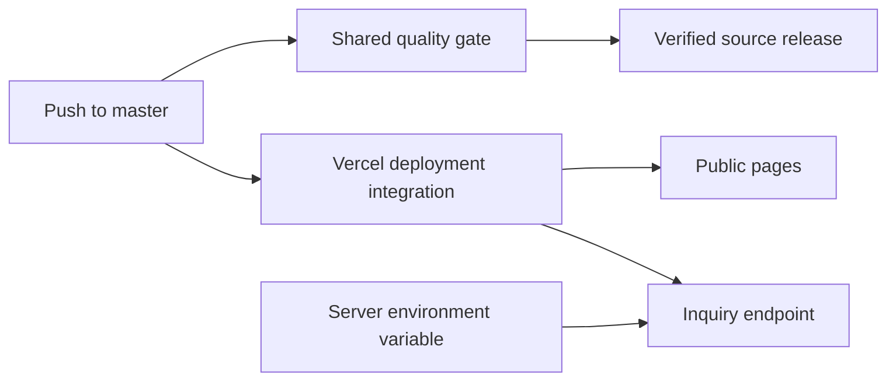

# Deployment

Vercel hosts the site. Select the Astro framework preset and Node 24. Use
`bun install --frozen-lockfile` for installation and `bun run build` for the build.
The Astro Vercel adapter emits `.vercel/output/` with static pages and the inquiry
server function; a static-only host cannot run the inquiry endpoint.

## Inquiry configuration

Set `FORMCARRY_URL` to the existing HTTPS Formcarry endpoint in Vercel’s server
configuration. For local development, use `.env` as shown in `.env.example`.
Do not expose the value under a `PUBLIC_` prefix or place it in client code.

If delivery is unavailable, visitors retain their draft and can retry, download,
or open an email draft. Formcarry’s acceptance confirms submission to the provider,
not delivery to a recipient’s inbox.

The existing Vercel Git integration controls deployments independently of GitHub
source releases. A release workflow does not call a deployment API or alter domain
settings. Configure any deployment gating in the hosting project itself.

After deployment, check the public URL, original PDF links, social metadata, and
server environment. Use an explicitly approved test inquiry if end-to-end email
delivery needs checking; the automated tests deliberately mock it.

[Releases](releases.md) · [Back to documentation](../README.md)
