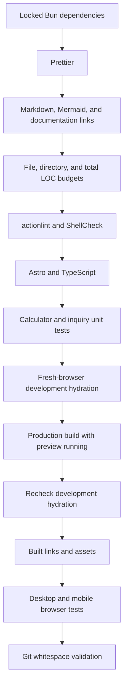

# Quality gate and source budgets

Run `bun run check` inside Flox. CI and `.githooks/pre-commit` invoke the same
script; neither uses a shortened version of the checks.

## Source size

`scripts/budgets.json` caps physical source lines per file, files per directory,
and total maintained lines. Generated assets, vendor files, and lockfiles do not
count. Blank lines still count; minification is not a substitute for cohesive
modules. Split by responsibility and remove obsolete code before raising a cap.

New and tracked files are both checked, while deleted files are ignored. A budget
failure names the file or directory and its limit. Changes to limits should be
explained in the commit or review.

## Documentation

Markdownlint checks structure and code-fence languages. The Mermaid parser checks
each diagram’s syntax. The documentation validator checks relative links, image
paths, and Markdown heading anchors without depending on external website uptime.

## Browser and server checks

`test:dev` verifies the asset library, calculator, and inquiry form in fresh
browser contexts before and after a production build while the dev server stays
running. Separate Vite caches prevent development and production JSX runtimes
from interfering. Build output is excluded from preview file watching.

Playwright exercises the built site at desktop and phone sizes, including
navigation, search, dropdowns, forms, filtering, calculators, and downloads.
It starts its own server on port 4323 and leaves a running development preview
alone. `PLAYWRIGHT_BASE_URL` can target an existing preview deliberately.

All delivery tests use mocks; they do not send emails. On CI failure, browser
traces remain available as a short-lived artifact. Static output is archived
only after the gate passes, without server bundles or environment files.

[Setup](setup.md) · [Back to documentation](../README.md)
