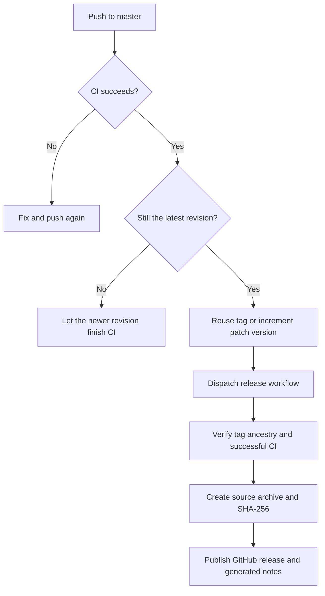

# Automatic releases

A successful `ci` push run on `master` triggers `auto-release`. The workflow checks
out the exact successful commit, confirms it is still the default-branch head,
and assigns the next patch tag. Pull requests cannot trigger publication.

The first tag is `v0.1.0`; subsequent automatic releases increment the patch
component of the latest stable semantic-version tag. Tags identify snapshots;
the package manifest is not rewritten by a release workflow.

## Recovery and manual publication

Use the Actions interface to rerun a failed auto-release or release job. Existing
tags are reused, and release assets can be uploaded again without creating a
second release. The explicit dispatch is needed because tags pushed with GitHub’s
automation token do not trigger another workflow automatically.

For manual dispatch, supply an existing `vMAJOR.MINOR.PATCH` tag. The release job
rejects malformed tags, commits outside `master` history, and commits without a
successful push CI run. Archives contain tracked source and a checksum, not local
environment variables or build-time credentials.

## Maintenance

Workflows use immutable action revisions, bounded execution times, read-only CI
permissions, and separately scoped publication permissions. Dependabot proposes
weekly action updates. `CI_RUNNER` can select an available compatible runner;
Ubuntu 24.04 is the default.

[Back to documentation](../README.md)
