# Contact JEA

Use **Start a conversation** to introduce your company and priorities. Keep this
initial message non-confidential. For direct contact, use
[jeabizdev@gmail.com](mailto:jeabizdev@gmail.com).

## Prepare your introduction

Provide your name, a valid email address, company, and a short description of your
priorities. You can also select an asset, territories, timeline, and preferred
engagement model. The dropdowns support mouse, touch, arrow keys, type-to-find,
Enter, and Escape.

The review button remains disabled until all required details are valid and the
consent box is checked. The note below the button explains what is needed.

```mermaid
stateDiagram-v2
  [*] --> Draft
  Draft --> Ready: Required details and consent complete
  Ready --> Review: Review my introduction
  Review --> Draft: Edit details
  Review --> Sending: Send to JEA
  Sending --> Sent: Delivery accepted
  Sending --> Review: Delivery fails; draft retained
  Review --> Email: Open email draft
  Review --> Download: Download introduction
```

## Send or save

Review the text before choosing a delivery option:

- **Send to JEA** submits through the website’s configured delivery service.
  A confirmation and brief blue confetti celebration appear only after the service
  accepts the request. Confetti is skipped when reduced motion is enabled.
- **Open email draft** opens your email application. You must send the message
  there; opening a draft does not complete the inquiry.
- **Download introduction** saves a text copy to your device.

If delivery fails, your introduction stays visible. Retry or use the email draft.
For an uncertain delivery result, check your email or contact JEA before repeating
sensitive details. Refreshing the page clears the unsaved draft.

Submitting an inquiry starts a conversation; engagement scope, fees, and terms
are agreed separately. The website links to JEA’s existing privacy policy and
disclaimer.

[Back to documentation](../README.md)
