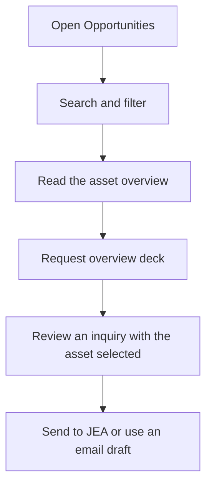

# Explore opportunities and transactions

## Find an asset

The Opportunities page lists published partnering assets. Search by asset, target,
modality, or stage. Combine the therapeutic-area buttons with the development-stage
selector, then sort by stage or name. If no assets match, reset the filters.

Each detail page shows the target, therapeutic area, modality, listed stage, and
source description. **Request overview deck** carries the selected asset into the
inquiry form so you do not need to retype its name.

Descriptions preserve existing JEA materials, including historical plans and
sponsor-reported data. Confirm current availability, development status, rights,
and supporting evidence directly with JEA.

## Read transaction materials

Open **Resources → Track record** to browse client announcements. Filter by year
or search for a company or agreement. **Read announcement** opens the original
PDF in a new tab. The PDF badge identifies the document format.

The deal-summary section provides eight historical transaction summaries. These
materials are reference documents; headline values can include contingent
milestones rather than money already received.

[Contact JEA](inquiries.md) · [Back to documentation](../README.md)
