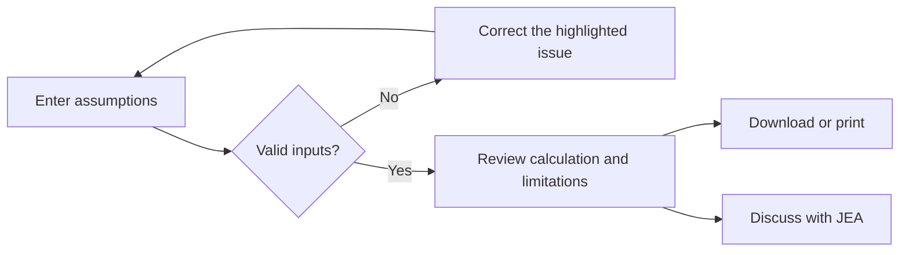

# Use the BD toolkit

The toolkit contains sixteen calculators across deal economics, capital planning,
and process planning. Search or select a category to find a tool, or use the
all-in-one workspace to switch calculators without leaving the page.

## Work through a scenario

1. Open a calculator and read its input labels, units, and assumptions.
2. Replace the illustrative values with your scenario.
3. Review the result and any breakdown. Invalid inputs show a message instead
   of a misleading result.
4. Download a text copy, print the page, or choose **Discuss this scenario** to
   start an inquiry with the tool name included.

**Reset to example** restores the initial values. Switching tools in the workspace
also starts the selected tool with its example; it does not preserve a portfolio
of scenarios.

## What the numbers mean

Money fields labeled **$M** use millions of US dollars. Some tools use whole dollar
amounts, percentages, hours, or months; read the label before entering a value.
Every tool’s guide explains its formula and provides a worked example.

These tools illustrate arithmetic using your assumptions. They do not provide
asset valuations, clinical forecasts, financial recommendations, or fee quotes.
They do not include every contractual or commercial consideration.

## Privacy

Inputs stay in the current browser tab and are not saved or sent to JEA. Reloading
resets them. A downloaded text file remains on your device. The discussion link
passes the tool’s name, not your financial inputs.

[Back to documentation](../README.md)
